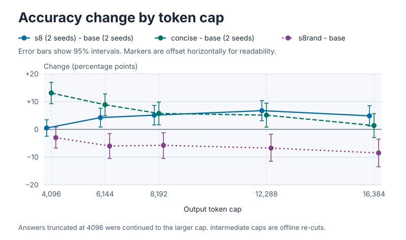

# bootstrap-rsi

**English** · [中文](README_zh.md)

> **We let an AI pull itself up by its own bootstraps: rewriting its own weights, generation after generation. How far does it get?**

Recursive self-improvement (RSI) has mostly lived in thought experiments: a model improves itself, the improved model improves itself again, and so on. This repository turns it into something you can measure on one Mac. **A model reads its own failed answers and writes code that edits its own weights, with no training of any kind. Edits it keeps are written into the model for good, and the edited model is the one that edits itself next.** Every generation is scored on problems it has never seen.

The research is carried out by AI agents: they design the experiments, write the code, run it, do the statistics, and a second model re-audits the numbers from the raw files. Humans set the direction and press "publish".

| | Status |
|---|---|
| **Step one: does a single weight edit help?** | ✅ Done, results below |
| **The recursive chain: generation after generation, how far?** | ⏳ Code and pre-registration are ready and queued. **No result yet.** |

**[→ Interactive report for step one (Chinese)](https://artificialzeng.github.io/bootstrap-rsi/)** · **[→ Long-form article (Chinese)](lab/handoff/codex/T16_article_v5_out.md)** · **[→ Pre-registration for the chain](lab/out/prereg_chain.md)**

## Step one: one edit, +4.9 points

The starting point is arXiv 2611.21885, *Language Models Can Rewrite Their Own Weights*: Qwen3.5-27B rewrites its own weights without training and gains 6.6 points on 490 math problems. We took the edit that model found for itself (`dt_bias` +0.5 on every linear-attention layer), applied it to the 4B sibling, Qwen3.5-4B, and re-tested at the paper's 16,384-token budget.

1. **Editing the weights does raise the score.** Accuracy goes up by **4.9 points** (95% CI +1.2 to +8.6, p=0.0095; the single pre-registered test).
2. **Editing at random lowers it.** Change the same elements by the same amount, but pick +0.5 or −0.5 at random for each one, and accuracy falls 8.5 points **below** baseline and 15.0 points below the paper's edit. The direction carries information.
3. **The gain comes from finishing on time.** Of 197 per-problem score changes, 196 are "ran out of tokens ↔ correct". No problem went from a wrong answer to a right one. When the model finishes within the cap it is almost always right; the edit changes how many answers finish.
4. **Under a tight budget, one sentence of prompt does over ten times more.** Adding "Think efficiently" gains 13.1 points at a 4,096-token cap, where the edit gains 0.5. At 16,384 tokens the prompt's gain is down to 1.4 and the edit has caught up.


| Qwen3.5-4B, 400 held-out problems | 4,096 | 8,192 | 12,288 | 16,384 |
|---|---:|---:|---:|---:|
| Baseline (two seeds) | 24.8% / 25.5% | 45.5% / 50.0% | 58.3% / 59.5% | 68.3% / 70.0% |
| The paper's edit (two seeds) | 25.8% / 25.5% | 51.0% / 54.8% | 64.3% / 67.0% | 74.8% / 73.3% |
| One-sentence prompt (one seed) | 38.3% | 53.5% | 64.0% | 70.5% |
| Random-sign control (one seed) | 21.8% | 39.8% | 51.5% | 59.8% |
| **Edit − baseline** | +0.5 | +5.1 | +6.8 | **+4.9 (pre-registered)** |
| **Prompt − baseline** | +13.1 | +5.8 | +5.1 | +1.4 |

An answer that reaches the cap without a final answer counts as wrong, as in the paper. Answers cut off at 4,096 tokens were continued to 8,192 and then 16,384 with each arm's own weights; 12,288 is the same answers re-cut at that length.



## The recursive chain: the next experiment

In the paper, each of the eight sessions starts from the original weights, so the sessions do not build on each other. We link them into a chain:

1. **Generation 1.** Qwen3-8B reads its own failed answers and hidden states and writes code that edits its own weights. The framework checks the edit once on 40 reserved problems, and the model decides to keep or withdraw it.
2. **A kept edit is written into the model.** In generation 2, the model that reasons, diagnoses and edits is itself the product of generation 1.
3. Up to 4 generations, up to 2 sessions each. The chain stops when a generation keeps no edit.
4. Every generation is scored on 400 problems the model never sees.

We will publish whichever of three outcomes happens: each generation beats the last; it climbs a step or two and stops; or the model cannot produce a single edit worth keeping. Step one points toward the second: the gain so far comes from finishing sooner, and that kind of gain has a ceiling. The analysis was written down before any session ran, in [prereg_chain.md](lab/out/prereg_chain.md). The code is the `chain` phase of [`lab/agent8b.py`](lab/agent8b.py).

## Limits

- **There is no recursive self-improvement result yet.** The headline is a question.
- Step one replicates "this edit works", not "the model finds this edit by itself". The chain is the test of the second claim.
- The models here are 4B and 8B; the paper used 27B. We sample 1 answer per problem per seed with 2 seeds; the paper sampled 8 answers per problem. The second seed alone is not significant (+3.25, p=0.19).
- The 8,192 and 16,384 results come from continuing truncated answers in segments. Whether that matches generating in one pass has only had limited checks.
- The prompt arm has one seed so far.
- The paper itself links its gain to fewer truncated answers (§3.6 and Appendix E.9). Our contribution is an independent replication and a per-problem attribution.

## Who did what

| Role | Who |
|---|---|
| Choosing the topic, setting direction, deciding to publish | Human |
| Experiment design, code, runs, statistics, reports | Claude (Fable 5.2, Claude Code) |
| Independent statistics audit, code review, related-work check, article drafts | GPT-6.2-sol (Codex CLI) |
| Protocol check against the paper, code review | DeepSeek |
| Compute | One Mac with 128 GB of memory, MLX |

The audit had teeth: it found that the 8,192-token result did not survive correction across the 60 comparisons in that table. We downgraded that result to exploratory and registered a single test before any 16,384-token number existed.

## The repository bootstraps itself too

- [AGENTS.md](AGENTS.md): the rules of the research loop (in Chinese). Point your own agent at it and it can carry on.
- [LESSONS.md](LESSONS.md): what the process got wrong (in Chinese). Each entry became a rule in AGENTS.md, so the next round is more reliable than the last.
- [ROADMAP.md](ROADMAP.md): open questions (in Chinese). Contributions are welcome, above all from anyone with a machine big enough for the 27B model.

## Reproduce

```bash
cd lab
python -m venv .venv && .venv/bin/pip install mlx-lm math-verify scipy numpy
.venv/bin/python mech.py --model q35-4b --no-cont --arms s8,s8rand,concise,reseed,s8@2000   # 4,096 cap, about 2 hours per arm
.venv/bin/python ext.py --model q35-4b --arms base,s8,concise --to 8192 --bs 128            # continue to 8,192
.venv/bin/python ext.py --model q35-4b --arms base,s8,concise --to 16384 --bs 64            # continue to 16,384
.venv/bin/python cap_table.py --caps 4096,8192,12288,16384                                   # tables
.venv/bin/python agent8b.py --phases reseed,chain --chain 4 --attempts 2                     # the recursive chain
```

You need Apple Silicon. We used 128 GB of memory; peak use was about 81 GB at batch size 128, so lower `--bs` on a smaller machine. Models and the MATH-500 problems are read from the Hugging Face cache; the model repositories are listed in `MODELS` in `mech.py`. The raw answer files (about 470 MB) are not in the repository and will be released separately.

## License

Code: MIT. Text, figures and result data: CC BY 4.0. Problems come from MATH-500; this repository does not contain the problem texts.
