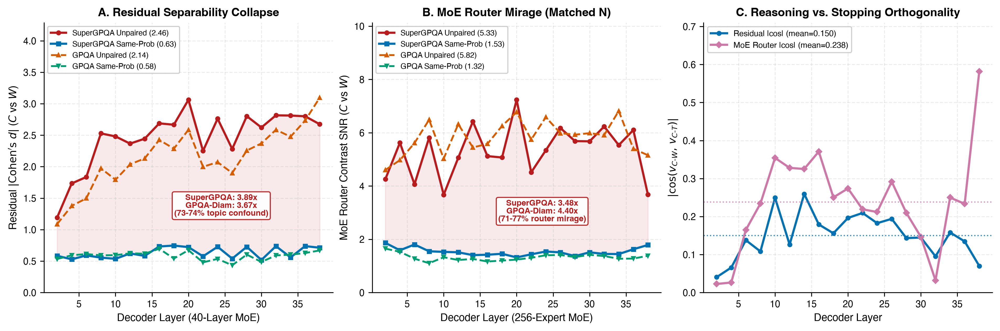
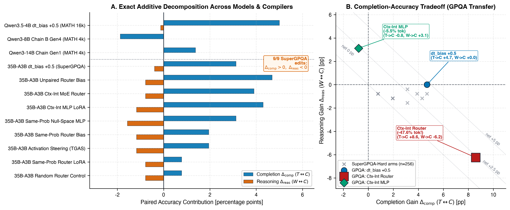
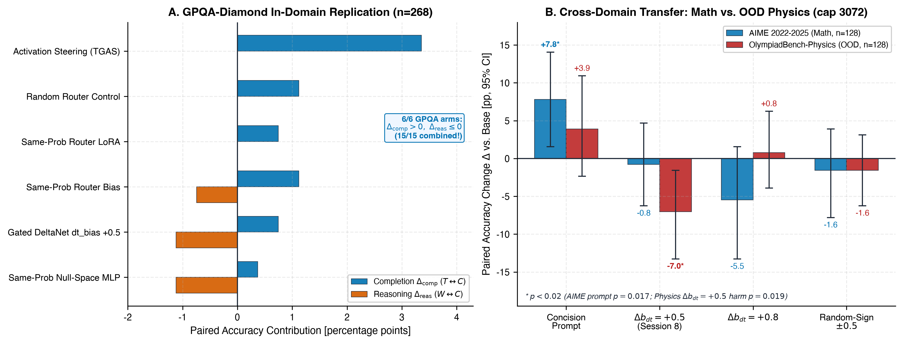

# The Completion-Only Ceiling (`bootstrap-rsi` v2)

**English** · [中文](README_zh.md) · **[Read the Paper (PDF)](paper/main.pdf)** · **[Legacy Branch (`claude-sabotage-version`)](../../tree/claude-sabotage-version)**

> **Why Training-Free Weight Self-Rewriting Fails to Compound Reasoning Across Dense and Sparse MoE Language Models**

> **Branch separation notice:** This `main` branch hosts the standalone **v2** research codebase, verified results, publication figures, and camera-ready 18-page manuscript ([`paper/main.pdf`](paper/main.pdf)). The earlier legacy research snapshots (Phase 1–2 BF16 harness and prior sessions) are preserved intact and separated on branch [`claude-sabotage-version`](../../tree/claude-sabotage-version).

---

## Core Findings at a Glance

Across **7 open-weight checkpoints** (dense Transformers, hybrid Gated DeltaNet architectures, and a 256-expert Mixture-of-Experts model: `Qwen3-1.7B/8B/14B` and `Qwen3.5-4B/9B/27B/35B-A3B`), **6 competition and graduate-science benchmarks** (`MATH-500`, temporally isolated `AIME 2010–2025`, `OlympiadBench-Physics`, `MMLU-Pro STEM`, `SuperGPQA-Hard`, `GPQA-Diamond`), and **8 training-free compilation mechanisms**, we establish five structural results:

1. **Universal Completion–Accuracy Tradeoff (15/15 Multi-Seed Graduate-Science Arms, $p = 6.1 \times 10^{-5}$)**
   - Using an exact, selection-bias-free additive decomposition $\Delta = \Delta_{\mathrm{comp}}\,(T\!\leftrightarrow\!C) + \Delta_{\mathrm{reas}}\,(W\!\leftrightarrow\!C)$, **15 out of 15** weight and activation interventions across **SuperGPQA-Hard** ($n=256$) and **GPQA-Diamond** ($n=268$) yield $\Delta_{\mathrm{comp}} > 0$ alongside $\Delta_{\mathrm{reas}} \le 0$ ($0/15$ positive $W\!\to\!C$).
   - Zero-shot transfer of context-internalized MoE Router weights to GPQA-Diamond permanently slashes token usage by **−47.6%** (`438.6 → 229.9` tokens, zero prompt overhead), gaining `+8.59 pp` via $T\!\to\!C$ at the direct cost of `−6.25 pp` via $W\!\to\!C$.

2. **Topic-Confounding Mirage Replicated Independently on Two Benchmarks**
   - Holding exact problem identity constant across all 40 layers of `Qwen3.5-35B-A3B` collapses apparent $C$-vs-$W$ residual separability by **3.89×** on SuperGPQA-Hard (`2.464 → 0.633`, 74.3% topic confounding) and **3.67×** on GPQA-Diamond (`2.141 → 0.584`, 72.7% confounding), and collapses 256-expert MoE Router SNR by **3.48×** and **4.40×** (71–77% confounding).
   - True reasoning ($C\text{-}W$) and stopping ($C\text{-}T$) directions are nearly orthogonal ($|\cos| = 0.150$ residual, $0.238$ router).

3. **Retention–Drift Phase Transition Theorem & Monte Carlo Proof**
   - Unthresholded small gates ($n_g = 40, z_{\min} = 0$) sustain a **27.0%** 4-generation false-survival rate and **+9.57 pp** cumulative Goodhart gap even for slightly harmful editors (explaining `Qwen3-8B Chain B`: 4/4 kept, `−1.88 pp` held-out).
   - Strict gates ($z_{\min} \ge 1.65$) crush drift but require $n_g \ge 256$ to retain genuine $+1.5\text{ pp}$ edits reliably.

4. **Thinking-Mode Failure Boundary & Statistically Significant OOD Harm**
   - Modern RL checkpoints exhibit self-calibrated stopping ($\mathrm{acc}|\mathrm{fin} = 91\text{--}100\%$ on MATH-500, MMLU-Pro STEM, and AIME), hiding reasoning errors until unlocked via Brief-CoT.
   - On `AIME 2024–2025` thinking mode (`cap=4096`), `dt_bias` dose sweeps `+0.3..+1.6` all score **0.0%** (100% truncated; literal looping starts at `+1.6`).
   - Under `nothink (cap=3072)`, a one-sentence concision prompt gains **`+7.81 pp` ($p = 0.017$)** on `AIME 2022–2025`, whereas Fan et al.'s `dt_bias +0.5` causes a **statistically significant `−7.03 pp` degradation ($p = 0.019$)** on zero-shot out-of-domain `OlympiadBench-Physics`.

5. **Native 4-Bit MoE Compilers & Transactional Harness (`v2/agent_v2.py`)**
   - Zero-dequantization LoRA and 256-expert Router wrappers over MLX `QuantizedLinear` run `Qwen3.5-35B-A3B` in **27.3 GB** peak Metal RAM at **120.8–202.8 tok/s** (**2.8× less RAM**, **3.5–4.5× faster** than legacy BF16 `Qwen3-14B`).
   - Read-only `tools.*` + atomic per-turn rollback cut autonomous turn error rates from **42.2%** (`27/64`) to **17.6%** (`3/17`), raised diagnostic engagement to **100%**, and eliminated ghost weight mutations.

---

## Key Figures





---

## Repository Structure

```text
.
├── paper/
│   ├── main.pdf                # Camera-ready 18-page manuscript
│   ├── main.tex                # LaTeX source
│   ├── tables_auto.tex         # Programmatically generated verified tables & macros
│   ├── refs.bib                # Verified BibTeX bibliography
│   └── figs/                   # All 6 vector PDF + 300-DPI PNG figures
├── v2/
│   ├── engine.py               # Native 4-bit MLX loader, cached eval & diagnostic extractor
│   ├── compilers.py            # MoE Router Bias/LoRA, Woodbury Null-Space MLP LoRA, Context Internalization
│   ├── agent_v2.py             # Read-only transactional autonomous self-rewriting harness
│   ├── benchmarks.py           # Temporally isolated AIME, OlympiadBench, SuperGPQA, GPQA, MMLU-Pro, MATH-500
│   ├── stats.py                # Exact 3x3 T/W/C decomposition, paired t/sign/bootstrap & strict gate
│   ├── theory_gate_phase.py    # 10,000-trial Monte Carlo Retention-Drift phase simulator
│   ├── exp_a_thinking_rescue.py
│   ├── exp_b_final_wc.py
│   ├── exp_d_gpqa_and_crossdomain.py
│   ├── verify_release.py       # One-command standalone verifier over data/*.json
│   ├── make_paper_figs.py      # Rebuilds all 6 publication figures directly from JSONs
│   └── test_v2_cpu.py          # CPU unit tests for benchmarks, stats, Woodbury & router compilers
├── data/                       # All verified experiment JSON artifacts & legacy baseline summaries
├── AGENTS.md                   # Research governance & experimental rules
├── LESSONS.md                  # Engineering and statistical lessons (1-12)
└── ROADMAP.md                  # Research roadmap
```

---

## Quick Verification & Reproduction

### 1. Instant CPU Verification (< 2 seconds, no GPU required)

```bash
python -m venv .venv && source .venv/bin/activate
pip install -e .

# Verify all headline tables, mirage ratios, and exact Delta == Delta_comp + Delta_reas identities
python v2/verify_release.py

# Regenerate all 6 publication figures (PDF + PNG) directly from data/*.json
python v2/make_paper_figs.py
```

### 2. Re-running GPU Experiments (Apple Silicon, MLX)

```bash
# Hardware microbenchmark (native 4-bit 9B / 27B / 35B-A3B MoE)
python v2/bench_gpu.py

# Exp A: Thinking-mode dt_bias dose sweep (+0.3..+1.6) on AIME 24-25 @ 4096
python v2/exp_a_thinking_rescue.py

# Exp B: SuperGPQA-Hard Mirage Proof, 11-arm editing & GPQA-Diamond zero-shot transfer
python v2/exp_b_final_wc.py

# Exp C: Transactional autonomous self-rewriting chains (Strict vs. Loose Gate)
python v2/agent_v2.py --model q35-35b --bench supergpqa_brief --cap 768 --n-prac 64 --n-gate 64 --n-eval 128 --gens 2 --attempts 2 --bs 64 --strict-gate
python v2/agent_v2.py --model q35-35b --bench supergpqa_brief --cap 768 --n-prac 64 --n-gate 40 --n-eval 128 --gens 2 --attempts 2 --bs 64 --loose-gate

# Exp D: GPQA-Diamond same-problem compilation & AIME -> OlympiadBench-Physics OOD transfer
python v2/exp_d_gpqa_and_crossdomain.py
```

---

## Citation

```bibtex
@misc{zeng2026completionceiling,
  author = {Zijian Zeng},
  title  = {The Completion-Only Ceiling: Why Training-Free Weight Self-Rewriting Fails to Compound Reasoning Across Dense and Sparse MoE Language Models},
  year   = {2026},
  url    = {https://github.com/ArtificialZeng/bootstrap-rsi}
}
```

## License

Code: MIT. Manuscript, figures, and summary data: CC BY 4.0.
