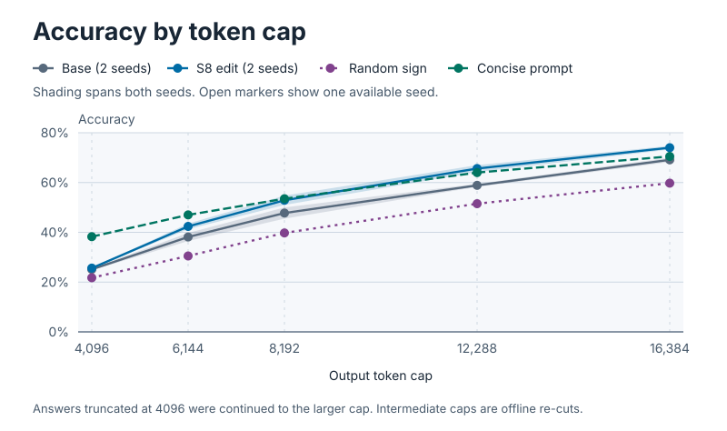

# 左脚踩右脚 · bootstrap-rsi

[English](README.md) · **中文**

> **震惊！我们让 AI 左脚踩右脚：一代一代改写自己的权重，它能上天吗？**

递归自我改进（RSI）一直停留在设想里：一个模型改进自己，改进后的模型再改进自己，如此往复。这个仓库在一台 Mac 上把它做成可以测量的实验：**模型拿到能读自己失败答案的工具，写代码直接改自己的权重，不经过任何训练；保留下来的修改写死进模型，下一代由改过的模型继续改自己。** 每一代都在它从没见过的题上打分。

整个研究由 AI 智能体执行：设计实验、写代码、跑实验、做统计，再由另一个模型从原始数据独立复核。人只负责定方向和按下"发布"。

| | 状态 |
|---|---|
| **第一级台阶：改一次权重，有没有用？** | ✅ 已完成，结果见下 |
| **递归链：一代接一代，能走多远？** | ✅ 第一条链（Qwen3-8B）已跑完：四代都保留了修改，**没有提升**（−1.9 分，p=0.10）。⏳ 第二条预先登记的链（Qwen3-14B）正在跑 |

**[→ 第一级台阶的交互式报告](https://artificialzeng.github.io/bootstrap-rsi/)** · **[→ 中文长文](lab/handoff/codex/T16_article_v5_out.md)** · **[→ 递归链的预设检验](lab/out/prereg_chain.md)**

## 第一级台阶：改一次，涨了 4.9 分

起点是 arXiv 2611.21885《Language Models Can Rewrite Their Own Weights》：Qwen3.5-27B 不经训练改写自身权重，在 490 道题上提高 6.6 个点。我们把论文里模型自己找到的那条编辑（所有线性注意力层 `dt_bias` +0.5）搬到同家族的 Qwen3.5-4B，用论文的 16,384 token 预算重测。

1. **改权重真的涨分。** 准确率提高 **4.9 个点**（95% 区间 +1.2 到 +8.6，p=0.0095，事先登记的唯一检验）。
2. **乱改会掉分。** 改同样的元素、同样的幅度，但每个元素随机取 +0.5 或 −0.5，准确率比基线**低** 8.5 个点，比论文的编辑低 15.0 个点。方向是有内容的。
3. **涨的分来自"把话说完"。** 197 次逐题成绩变化里，196 次是"到上限没说完 ↔ 答对"，没有一道题从答错变成答对。模型只要在上限内说完，几乎总是对的；编辑改变的是有多少回答能说完。
4. **一句提示词在紧预算下强十几倍。** 加一句 "Think efficiently" 在 4,096 token 时提高 13.1 个点（编辑只有 +0.5），到 16,384 时只剩 +1.4，被编辑追平。



| Qwen3.5-4B，400 道留出题 | 4,096 | 8,192 | 12,288 | 16,384 |
|---|---:|---:|---:|---:|
| 基线（两个种子） | 24.8% / 25.5% | 45.5% / 50.0% | 58.3% / 59.5% | 68.3% / 70.0% |
| 论文的编辑（两个种子） | 25.8% / 25.5% | 51.0% / 54.8% | 64.3% / 67.0% | 74.8% / 73.3% |
| 一句提示词（一个种子） | 38.3% | 53.5% | 64.0% | 70.5% |
| 随机符号对照（一个种子） | 21.8% | 39.8% | 51.5% | 59.8% |
| **编辑 − 基线** | +0.5 | +5.1 | +6.8 | **+4.9（预设检验）** |
| **提示词 − 基线** | +13.1 | +5.8 | +5.1 | +1.4 |


## 递归链：走了四代，没有变强

论文里的 8 次会话每次都从原始权重出发，互不相干。我们把它接成一条链：

1. **第 1 代**：Qwen3-8B 拿到能读自己失败答案和隐藏状态的工具，写代码改自己的权重。框架在 40 道预留题上检查一次，模型决定保留还是撤回。
2. **保留的修改写死进模型。** 第 2 代负责思考、诊断、动手的那个模型，本身就是上一代的产物。
3. 最多 4 代，每代最多 2 次会话；某一代没留下任何修改，链条就停。
4. 每一代都在 400 道它从没见过的题上打分。

**结果（B 链，Qwen3-8B，上限 4096 token）。** 每一代都保留了修改，但没有一代比原始模型高出“原始模型换个随机种子”的波动。

| 代 | 预留检查（40 题） | 400 题正确率 | 截断率 | 对第 0 代 | 变对 / 变错 |
|---|---|---|---|---|---|
| 0 | 无 | 52.25% | 47.50% | 无 | 无 |
| 0（换种子） | 无 | 53.75% | 46.00% | +1.50 | 21 / 15 |
| 1 | 62.5% → 65.0% | 53.25% | 46.50% | +1.00 | 20 / 16 |
| 2 | 65.0% → 60.0% | 51.25% | 48.75% | −1.00 | 21 / 25 |
| 3 | 60.0% → 62.5% | 52.00% | 47.75% | −0.25 | 16 / 17 |
| 4 | 62.5% → 65.0% | 51.00% | 49.00% | −1.25 | 14 / 19 |

**预先登记的检验**（第 4 代对第 0 代，两个种子，按题配对 t 检验）：**−1.9 分，95% 置信区间 [−4.1, +0.4]，p = 0.10。** 这条链没有让模型变强；区间包含 0，所以也不能说它让模型变差。

会话日志里看到的：

- **在噪声上保留修改。** 模型确认保留时，预留检查的净变化分别只有 +1、−2、+1、+1 道题（共 40 题）。第 2 代检查结果变差了它仍然保留，把单侧 p=0.86 读成“没有显著变差”。
- **从不看题。** 七次会话里，查看题目、参考答案、已存答案的工具一次都没被调用。
- **修改不来自诊断。** 所有生效的修改方向不是全 1 向量就是随机抽取。
- **变化几乎全是“写完没写完”。** 对第 0 代的 150 个逐题差异里，148 个是“token 用完”和“答对”之间的互换。

我们自己工具的两处缺陷，都在受影响的结果出现之前写进了[预设检验](lab/out/prereg_chain.md)的带日期补充说明：第一条链（A 链）的工具不显示返回值，跑完一代后停掉，结果只作探索性报告；一条有歧义的报错让第 4 代的一次会话没能跑成任何测试（那次会话自己撤回了）。上表是 B 链，即预先登记的那条。

**下一步。** 第二条预先登记的链换成 Qwen3-14B，看更大的模型当“修改者”时表现是否不同。代码在 [`lab/agent8b.py`](lab/agent8b.py) 的 `chain` 阶段，统计在 [`lab/chain_stats.py`](lab/chain_stats.py)，每次会话的完整记录在 [`lab/out/`](lab/out/)。

## 边界

- **没有观察到递归自我改进。** 这只是一条链、一个 8B 模型、一个基准、4096 token 上限；它不能说明更大的模型、别的工具或更严的保留规则下自我修改也不行。
- 保留还是撤回由模型自己定，没有数值门槛，而 40 道预留题只能分辨很大的效应。规则再严一点，这条链大概在第 1 代就停了。
- 第一级台阶复现的是"这条编辑有效"，不是"模型自己找到这条编辑"。
- 模型是 4B 和 8B，论文是 27B；每题每个种子 1 个回答、共 2 个种子，论文是每题 8 个回答；第二个种子单独看不显著（+3.25，p=0.19）。
- 8,192 和 16,384 的结果是把被截断的回答分段续写得到的，续写与一次生成到底是否等价只做了有限检查。
- 提示词目前只有一个种子。
- 论文自己在 §3.6 和附录 E.9 已经把提分与截断减少联系起来，我们做的是独立复现和逐题归因。

## 谁做了什么

| 角色 | 谁 |
|---|---|
| 选题、定方向、决定发布 | 人 |
| 设计实验、写代码、跑实验、统计、写报告 | Claude（Fable 5.2，Claude Code） |
| 独立统计复核、代码审查、相关工作核对、文章初稿 | GPT-6.2-sol（Codex CLI） |
| 论文协议核对、代码审查 | DeepSeek |
| 算力 | 一台 128 GB 内存的 Mac，MLX |

复核不是走过场：它查出 8,192 档的结果在 60 项比较的校正后不显著，我们因此把那个结果降级为探索，并在 16,384 档出数之前登记了唯一一项检验。

## 这个仓库自己也在左脚踩右脚

- [AGENTS.md](AGENTS.md)：研究循环的规则，任何人的智能体读了就能接着做。
- [LESSONS.md](LESSONS.md)：流程出过的错。每一条都变成了 AGENTS.md 里的一条规则，下一轮研究因此比上一轮可靠。
- [ROADMAP.md](ROADMAP.md)：还没回答的问题，欢迎认领，尤其是有大机器、能跑 27B 的人。

## 复现

```bash
cd lab
python -m venv .venv && .venv/bin/pip install mlx-lm math-verify scipy numpy
.venv/bin/python mech.py --model q35-4b --no-cont --arms s8,s8rand,concise,reseed,s8@2000   # 4,096 档，每个臂约 2 小时
.venv/bin/python ext.py --model q35-4b --arms base,s8,concise --to 8192 --bs 128            # 续写到 8,192
.venv/bin/python ext.py --model q35-4b --arms base,s8,concise --to 16384 --bs 64            # 续写到 16,384
.venv/bin/python cap_table.py --caps 4096,8192,12288,16384                                   # 出表
.venv/bin/python agent8b.py --phases reseed,chain --chain 4 --attempts 2 --echo --chain-name B   # 递归链（B 链）
.venv/bin/python chain_stats.py --chain-name B                                                # 预先登记的检验
```

需要 Apple Silicon；我们用的是 128 GB 内存，批大小 128 时峰值占用约 81 GB，内存小就调小 `--bs`。模型和 MATH-500 题集从 Hugging Face 缓存读取，模型仓库名见 `mech.py` 里的 `MODELS`。原始回答文件约 470 MB，没有放进仓库，会单独发布。

## 许可

代码：MIT。文字、图表和结果数据：CC BY 4.0。题目来自 MATH-500，本仓库不包含题目原文。
