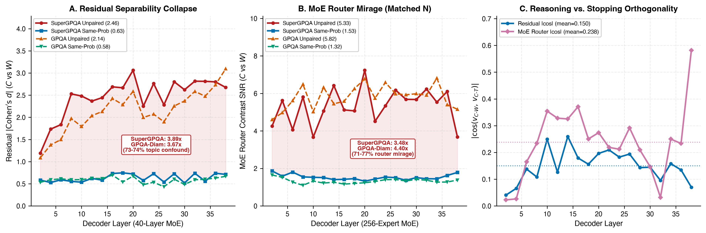
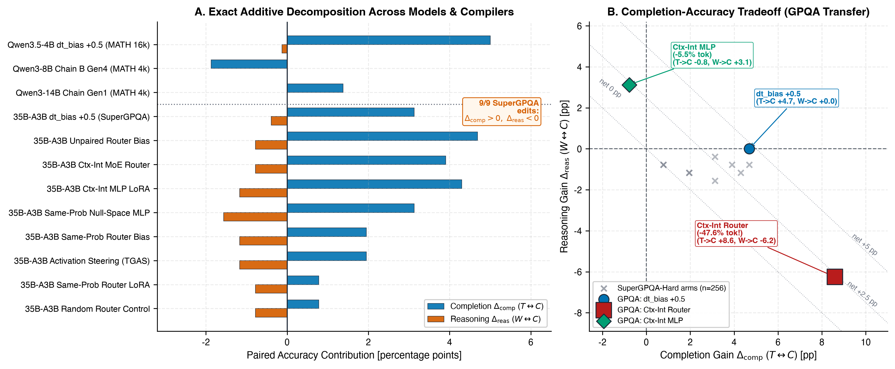
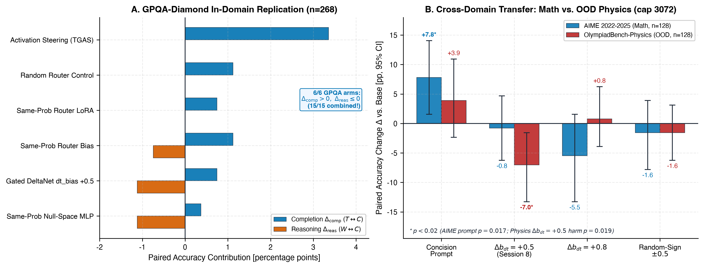

# 仅限完成率的天花板 · The Completion-Only Ceiling（`bootstrap-rsi` v2）

[English](README.md) · **中文** · **[阅读完整论文（PDF）](paper/main.pdf)** · **[历史归档分支（`claude-sabotage-version`）](../../tree/claude-sabotage-version)**

> **为什么训练无关的权重自改写无法在稠密与稀疏 MoE 大模型上实现推理能力的跨代复利**

> **分支割裂说明**：本 `main` 分支为完全独立的 **v2** 研究成果发布，包含全新的原生 4-bit 稀疏 MoE 权重编译器、事务型自主沙盒 `agent_v2`、已核验实验数据、6 张顶刊风格矢量图以及 18 页完整论文（[`paper/main.pdf`](paper/main.pdf)）。早期历史版本（传统 BF16 沙盒与过往研究记录）已完整隔离归档至 [`claude-sabotage-version`](../../tree/claude-sabotage-version) 分支。

---

## 五大核心突破速览

横跨 **7 个开源模型**（稠密 Transformer、混合 Gated DeltaNet 架构及 256 专家稀疏 MoE：`Qwen3-1.7B/8B/14B`、`Qwen3.5-4B/9B/27B/35B-A3B`）、**6 个高难竞赛与研究生科学基准**（`MATH-500`、时间严格隔离的 `AIME 2010–2025`、`OlympiadBench-Physics`、`MMLU-Pro STEM`、`SuperGPQA-Hard`、`GPQA-Diamond`）以及 **8 种训练无关改权重机制**，本研究建立五项核心结论：

1. **普遍的「完成率–正确率权衡」律（15/15 组高难科学题，$p = 6.1 \times 10^{-5}$）**
   - 通过精确无选择偏差的配对分解 $\Delta = \Delta_{\mathrm{comp}}\,(T\!\leftrightarrow\!C) + \Delta_{\mathrm{reas}}\,(W\!\leftrightarrow\!C)$，我们在 **SuperGPQA-Hard**（$n=256$）与 **GPQA-Diamond**（$n=268$）上测得 **15/15 组**权重与激活编辑均表现为 $\Delta_{\mathrm{comp}} > 0$ 且 $\Delta_{\mathrm{reas}} \le 0$（`0/15` 正向 $W\!\to\!C$）。
   - 上下文内化 MoE 路由权重零样本迁移到 GPQA-Diamond 时，在**无提示词开销**下永久削减 **47.6% token**（`438.6 → 229.9`），但 `+8.59 pp` 的少截断收益直接以 `−6.25 pp` 的已完卷推理正确率下滑为代价。

2. **两个独立基准一致证实「主题混淆海市蜃楼」**
   - 在 40 层 `Qwen3.5-35B-A3B` 上严格控制**同一题目的正反采样对**后，表面 $C$-vs-$W$ 残差可分性 $|d|$ 在 SuperGPQA-Hard 上坍塌 **3.89×**（`2.464 → 0.633`，74.3% 为主题混淆）、在 GPQA-Diamond 上坍塌 **3.67×**（`2.141 → 0.584`，72.7% 为主题混淆）；256 专家 MoE 路由 SNR 分别坍塌 **3.48×** 与 **4.40×**（71%–77% 混淆）。
   - 真实纠错方向（$C\text{-}W$）与停机方向（$C\text{-}T$）在残差与路由空间几乎正交（$|\cos| = 0.150 / 0.238$）。

3. **递归自改写的「保留–漂移相变定理」**
   - 推导闭式配对门控方差、$G$ 代存活率与逆米尔斯比 Goodhart 膨胀上界，并以 10,000 次蒙特卡洛链模拟验证：小样本无门槛门控（$n_g=40, z_{\min}=0$）会让微害编辑者以 **27.0%** 概率存活 4 代并积累 **+9.57 pp** 虚假门控涨幅（精准解释 Qwen3-8B 链 4/4 保留却跌 `−1.88 pp`）；严格门控（$z_{\min}\ge 1.65$）消除漂移，但要求 $n_g \ge 256$ 才能稳定检出真实的 `+1.5 pp` 提升。

4. **思考模式失效边界与域外物理显著退化**
   - 揭示现代 RL 推理模型的自校准停机机制（MATH-500、MMLU-Pro STEM、AIME 上 $\mathrm{acc}|\mathrm{fin}=91\%\text{--}100\%$），并用 Brief-CoT 协议解锁真实 $W$ 错题空间。
   - 在 `AIME 2024–2025` 思考模式（`cap=4096`）下，`dt_bias` `+0.3..+1.6` 全剂量归零失效（`0.0%`，`+1.6` 触发字面循环）。
   - 在 `nothink (cap=3072)` 下，一句简洁提示在 `AIME 2022–2025` 上显著涨分 **`+7.81 pp`（$p = 0.017$）**；而 Fan et al. 的 `dt_bias +0.5` 迁移到域外 `OlympiadBench-Physics` 时导致**统计显著的 `−7.03 pp` 退化（$p = 0.019$）**。

5. **原生 4-bit 稀疏 MoE 编译器 + 事务型自主沙盒（`v2/agent_v2.py`）**
   - 零反量化 LoRA 与 256 专家 Router 包装器让 35B-A3B MoE 在单台 128 GB Mac 上以 **27.3 GB 峰值显存**跑出 **120.8–202.8 tok/s**（较传统 BF16 14B 省 **2.8× 内存**、快 **3.5–4.5×**）。
   - 只读 `tools.*` 命名空间 + 按回合原子回滚将自主回合报错率从 **42.2%**（`27/64`）压至 **17.6%**（`3/17`），诊断调用率提至 **100%**，幽灵权重污染归零。

---

## 核心图表





---

## 快速验证与复现

```bash
python -m venv .venv && source .venv/bin/activate
pip install -e .

# 1. 无需 GPU：一键核验所有实验数字、海市蜃楼倍比与精确恒等式（< 2 秒）
python v2/verify_release.py

# 2. 无需 GPU：直接从 data/*.json 重绘全部 6 张顶刊级矢量图（PDF + PNG）
python v2/make_paper_figs.py
```

GPU 实验脚本（Apple Silicon MLX）均位于 [`v2/`](v2/) 目录，完整命令见英文 [README.md](README.md)。

## 许可

代码：MIT；论文文本、图表与汇总数据：CC BY 4.0。
